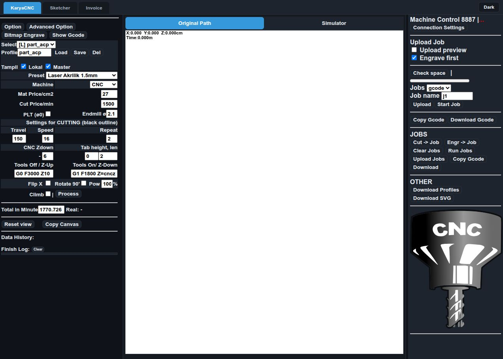
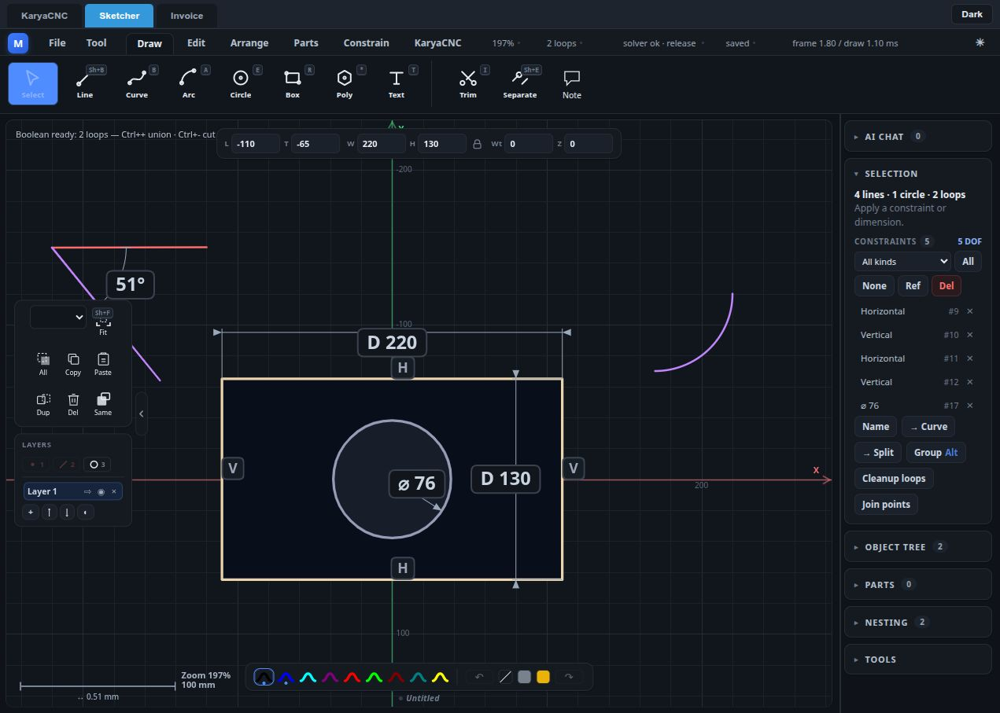
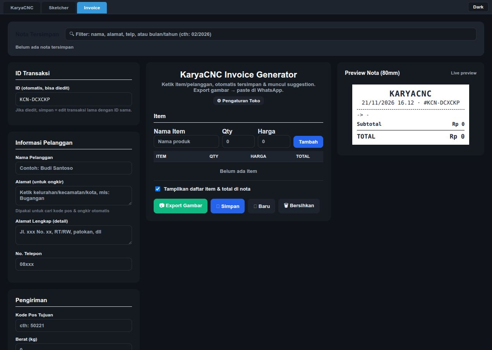

# KaryaCNC

Aplikasi desktop untuk mengontrol mesin CNC, laser cutter, dan plasma cutter. Dibangun dengan [Wails](https://wails.io/) (Go backend + web frontend), satu binary untuk Windows dan Linux.



## Fitur

### G-code Editor & Generator
- Editor G-code dengan syntax highlighting (Ace Editor)
- Generate G-code dari gambar (bitmap engraving via Potrace), SVG, dan bentuk dasar
- Simulator untuk preview hasil sebelum kirim ke mesin
- Estimasi biaya material & waktu pengerjaan real-time

### Machine Control
- Koneksi TCP langsung ke mesin CNC (port configurable, default 8888)
- Real-time machine position (X, Y, Z, velocity) via binary protocol
- Job monitoring: nama job, status, progress
- Upload job langsung ke mesin (multipart, max 32MB)

### Sketcher (MiniSketch)
Sketsa 2D parametrik dengan constraint solver:



- Drawing tools: line, curve, arc, circle, box, polygon, text
- Constraints: horizontal, vertical, dimensi, dll
- Boolean operations (union, cut), nesting untuk optimasi material
- AI chat assistant
- Export langsung ke G-code KaryaCNC

### Invoice Generator


- Nota 80mm untuk thermal printer, export gambar untuk WhatsApp
- Integrasi RajaOngkir (cek ongkir otomatis dari alamat)
- Data transaksi tersimpan, filter by nama/bulan

### Auto-Update
Aplikasi update otomatis dari GitHub Releases:
- Frontend (UI, Sketcher, Invoice) update tanpa download binary baru
- Delta update: hanya file yang berubah yang di-download (verifikasi sha256)
- Fallback embedded: tetap jalan walau offline / gagal download
- Tombol "Check Web Update" manual di settings

### Lainnya
- WebSocket server (port 8887) untuk terima G-code dari aplikasi eksternal (Inkscape extension tersedia)
- HTTP server (port 3000) untuk invoice & API
- Dark/Light theme
- Multi-profile mesin (preset material, kecepatan, harga per cm2)

## Download

Ambil binary terbaru dari [Releases](https://github.com/ryannining/karyacnc_x/releases):

| Platform | File |
|---|---|
| Windows | `karyacnc-windows-vX.Y.Z.exe` |
| Linux | `karyacnc-linux-vX.Y.Z` |

Tidak ada dependensi eksternal yang perlu diinstall (Windows: WebView2 built-in; Linux: WebKitGTK).

### Menjalankan

```bash
# Linux
chmod +x karyacnc-linux-v1.0.6
./karyacnc-linux-v1.0.6

# Windows
karyacnc-windows-v1.0.6.exe
```

Mode browser (Linux, lebih cepat dari WebKitGTK): otomatis pakai Chrome/Chromium jika tersedia. Paksa mode tertentu:

```bash
./karyacnc --browser   # Chrome/Chromium --app
./karyacnc --webview   # WebKitGTK native
```

## Update

Aplikasi cek update otomatis saat startup. Manual: **Connection Settings → Check Web Update**.

Update kode (untuk developer):

```bash
# Web update saja (frontend/minisketch/invoice)
./release.sh -m "pesan commit"

# Web + binary release baru
./release.sh -m "pesan commit" -v v1.0.7
```

## Development

### Struktur

```
karyacnc/
├── app.go              # Backend Go: machine control, HTTP, WebSocket
├── main.go             # Entry point Wails
├── bridge.go           # Browser mode (Chrome --app) bridge
├── updater.go          # Auto-update web dari GitHub Releases
├── frontend/
│   ├── index.html      # UI utama
│   ├── public/         # Static assets (JS)
│   └── dist/           # Hasil build (di-embed ke binary)
├── minisketch/         # Sketcher 2D (vanilla JS)
├── tools_invoice/      # Invoice generator
├── inkscape_ex/        # Ekstensi Inkscape
└── tools/              # Utilitas build
```

### Build

```bash
# Frontend
cd frontend && npm install && npm run build

# Binary (butuh Go 1.23+ dan Wails CLI)
wails build -debug   # dengan devtools
wails build          # production
```

Release via CI: `gh workflow run "Build Binary" -f version=vX.Y.Z`

### Tech Stack

- **Backend**: Go 1.23+, Wails v2.11
- **Frontend**: Vanilla JS, Vite, Ace Editor, Potrace, Clipper
- **Komunikasi**: WebSocket (external client), TCP binary protocol (mesin), Wails bridge (browser mode)

## License

Private project.
